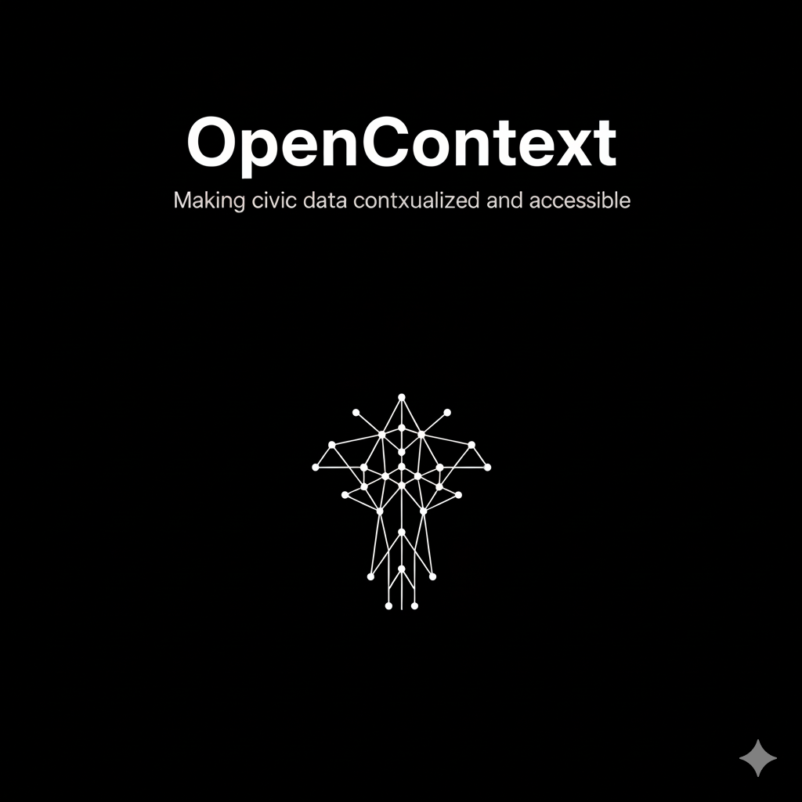

# OpenContext

<p align="center">
  
</p>

[](https://opensource.org/licenses/MIT)
[](https://www.python.org/downloads/)
[](https://modelcontextprotocol.io/)

---

## Anchorage Municipal Code MCP

This fork of OpenContext runs one plugin, `ecode`, which gives read-only
access to the Municipality of Anchorage municipal code as published on
eCode360. It is deployed at `https://anchorage-ecode.codeforanchorage.org/mcp`
and can be added to Claude as a custom connector with that URL.

Results are the published code text, not legal advice. Every result carries
the section number and an `https://ecode360.com/<guid>` link for verification.

### Tools

| Tool | Arguments | What it does |
| --- | --- | --- |
| `search_code` | `query`, `page` (default 0), `within` (optional) | Full-text search of the code. Returns up to 20 sections per page, each with its number, title, a snippet and a guid. Terms side by side are matched with OR; use quotes, `AND` and `NOT` for precise queries. `within` (`Title 9`, `Chapter 9.28`, a section number or a guid) keeps only the hits under that part of the code. |
| `get_table_of_contents` | none | The outline of the code: titles and chapters down to section level, without body text. |
| `browse_structure` | `guid` (default `ROOT`) | One node of the hierarchy and its immediate children, for walking the outline. |
| `get_section` | `guid`, `offset` (default 0) | Full text of a section and its subsections, with any attachments listed. Up to 40,000 characters come back per call; a longer section says so and gives the `offset` to continue from. Accepts a guid, a section number (`21.05.010`), or a chapter or title reference (`Chapter 17.05`, `Title 21`). The text of a very large node, such as a whole title, is cut at a size cap and flagged with a `node_too_large` caveat; read its chapters or sections individually. |
| `get_sections` | `sections` | Full text of up to 10 sections in one call, by guid or number. A section that cannot be fetched is reported in place without failing the rest. |
| `find_definition` | `term` | How the code defines a term: the defined term, its full text and the section it is defined in. A term defined in several places returns up to 8 definitions, flagged with a caveat. |
| `find_references` | `section`, `page` (default 0) | Where the rest of the code cites a section: its row in a fine schedule, penalty sections and other sections that refer to it, including citations to its subsections. Fine and penalty sections are listed first. |
| `read_attachment` | `url`, `page` (default 1), `layout` (default true) | Text of a PDF the code publishes as an attachment, chiefly tables that are not in the section text, such as Table 21.05-1 (allowed uses by zoning district). Only attachment URLs on ecode360.com are accepted. |
| `get_customer_info` | none | Metadata about the code library: official name, state, last-updated date and public URL. |

Tool names are prefixed with the plugin name on the wire, for example
`ecode__search_code`. See [Security](docs/SECURITY.md) for the limits on what
`read_attachment` will fetch.

---

## Quick Start

```bash
# 1. Configure (create config, enable one data source)
cp config-example.yaml config.yaml
# Edit config.yaml - set enabled: true for one plugin

# 2. Test locally
pip install aiohttp
python3 scripts/local_server.py

# 3. Deploy
./scripts/deploy.sh
```

Connect via **Claude Connectors** (same steps on both Claude.ai and Claude Desktop):

1. Go to **Settings** → **Connectors** (or **Customize** → **Connectors** on claude.ai)
2. Click **Add custom connector**
3. Enter a name (e.g. "Anchorage Municipal Code") and the server URL: `https://anchorage-ecode.codeforanchorage.org/mcp` for the hosted server, or your own API Gateway URL if you deployed a copy

Get the URL of your own deployment: `cd terraform/aws && terraform output -raw api_gateway_url`

See [Getting Started](docs/GETTING_STARTED.md) for full setup.

---

## Documentation


| Doc                                        | Description                                     |
| ------------------------------------------ | ----------------------------------------------- |
| [Quick Start](docs/QUICKSTART.md)          | Use the hosted server from Claude               |
| [Getting Started](docs/GETTING_STARTED.md) | Run it locally or deploy a copy                 |
| [The eCode plugin](docs/BUILT_IN_PLUGINS.md) | Tools, configuration and limits               |
| [Architecture](docs/ARCHITECTURE.md)       | System design and plugins                       |
| [Deployment](docs/DEPLOYMENT.md)           | AWS, Terraform, monitoring                      |
| [Testing](docs/TESTING.md)                 | Local testing (Terminal, Claude, MCP Inspector) |
| [Security](docs/SECURITY.md)               | Threat model and the attachment fetch limits    |
| [FAQ](docs/FAQ.md)                         | Common questions                                |


---

## Examples

- **This server's configuration:** [config.yaml](config.yaml) (the `ecode` plugin, its settings and the instructions sent to clients)
- **This server's plugin:** [plugins/ecode/plugin.py](plugins/ecode/plugin.py)
- **Writing your own plugin:** [docs/CUSTOM_PLUGINS.md](docs/CUSTOM_PLUGINS.md)
- **Generic CKAN, ArcGIS and Socrata plugins:** not in this fork; see upstream [CityOfBoston/OpenContext](https://github.com/CityOfBoston/OpenContext)

---

## Contributing

Pre-commit hooks (optional):

```bash
pip install pre-commit
pre-commit install
```

Hooks: Ruff, yamllint, gofmt. Run manually: `pre-commit run --all-files`.

---

## License

MIT — see [LICENSE](LICENSE).

**OpenContext author:** Srihari Raman, City of Boston Department of Innovation and Technology

**This fork** (the Anchorage Municipal Code MCP server and its `ecode` plugin) is maintained by [Code for Anchorage](https://github.com/codeforanchorage).
